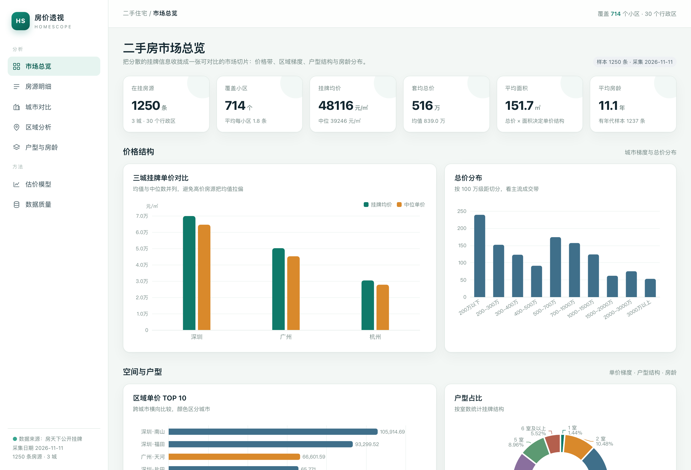
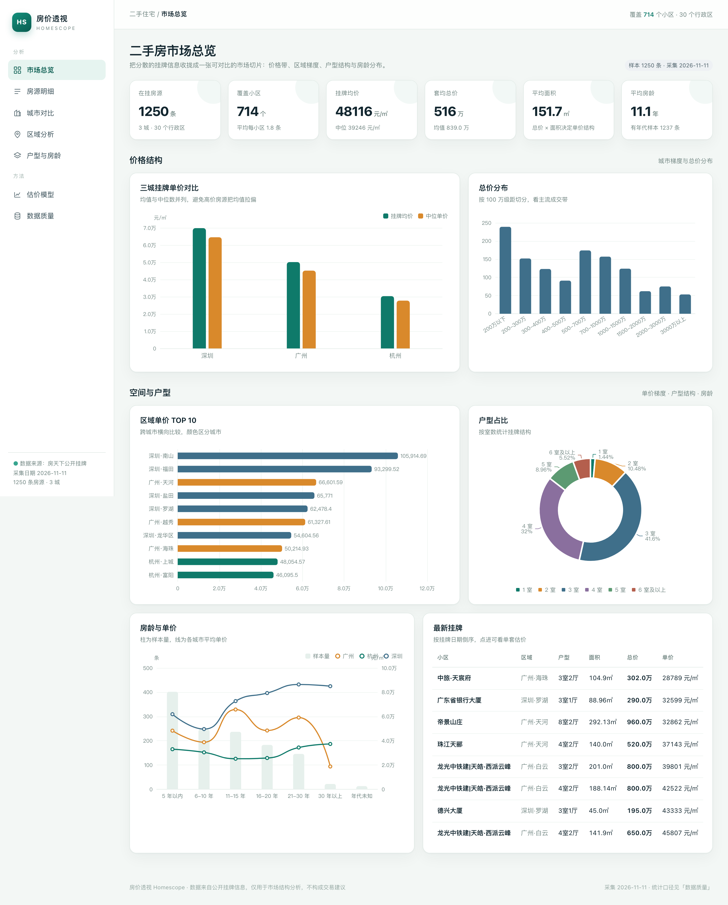
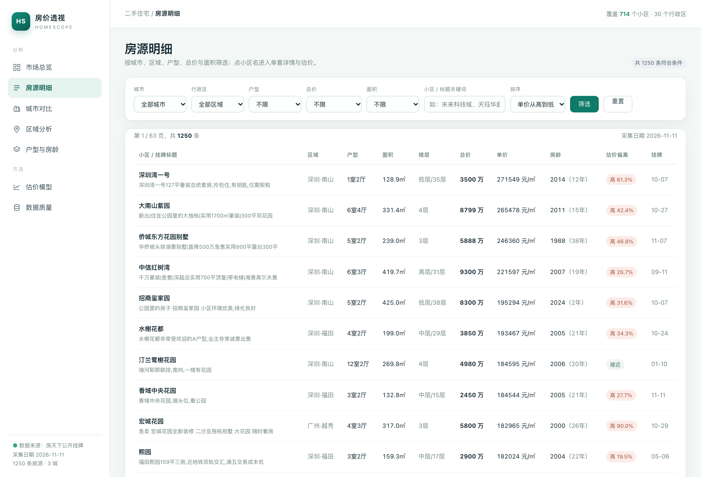
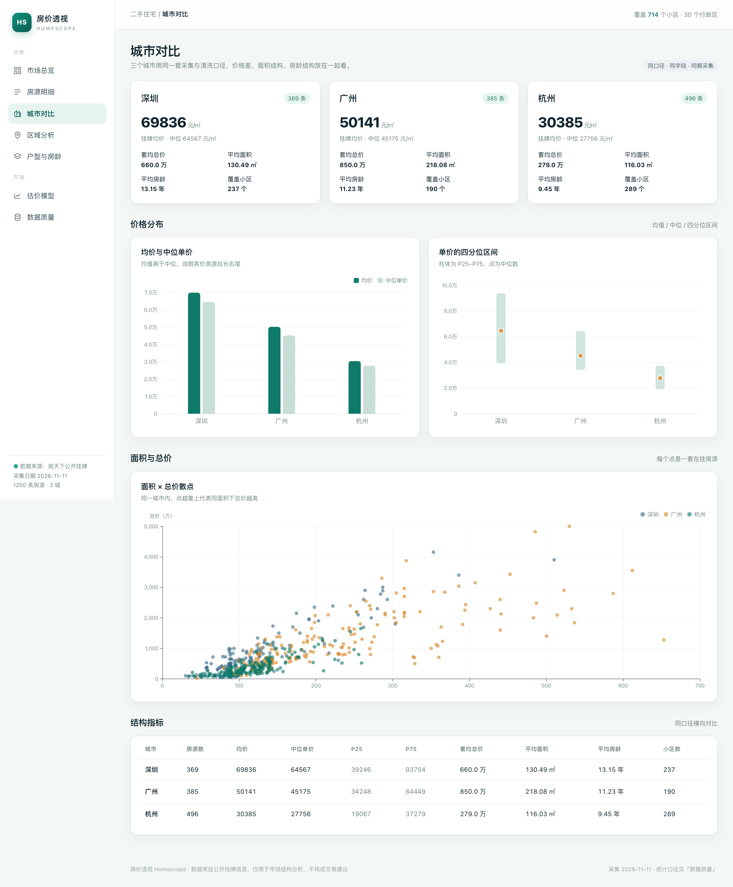
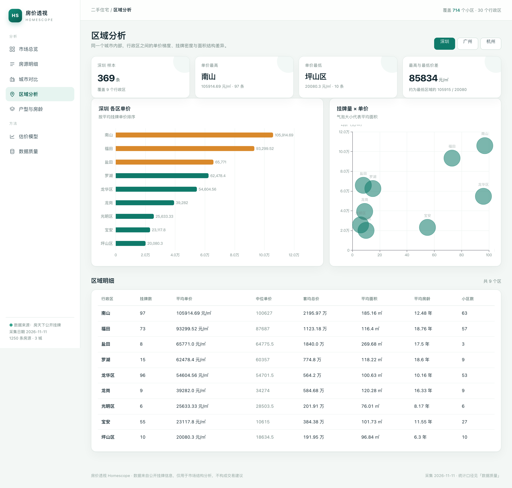
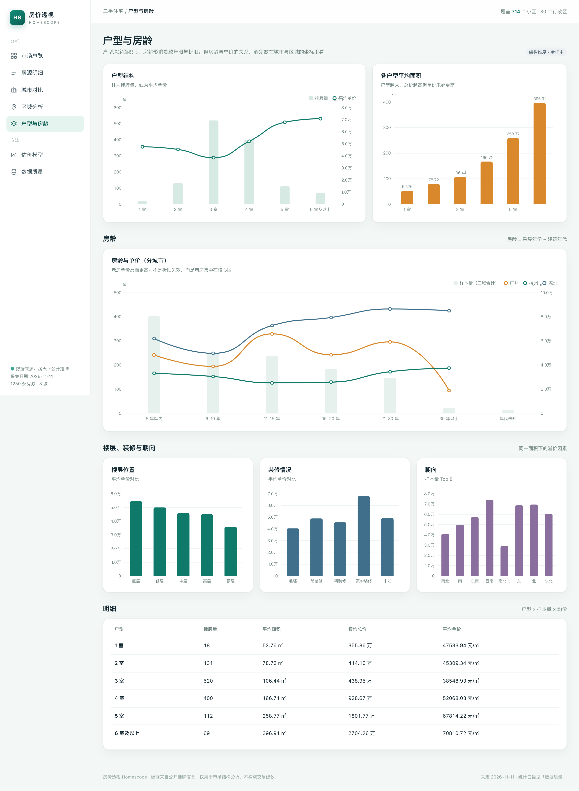
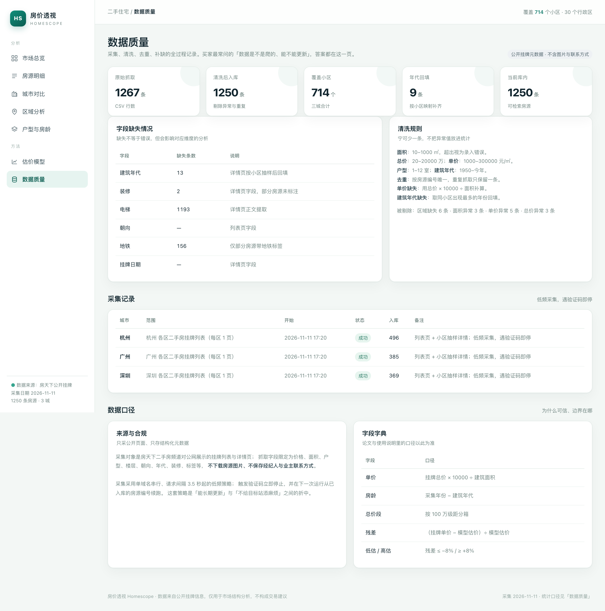

# 031 基于Scrapy与Django的二手房数据采集与可视化分析系统-设计展示

> **代码有偿获取 可接受定制 微信联系方式: csbysj2020 或 ACE2487，备注(BS)**

> **完整源码与全套文档 · 在线自助获取 >>> [https://mbd.pub/o/bread/YZaWlpxvZw==](https://mbd.pub/o/bread/YZaWlpxvZw==)**

> **成品页（功能介绍 / 更多选题）>>> [https://bishe.suilang.net/products/housing-lens](https://bishe.suilang.net/products/housing-lens)**

> 

> 

## 视频

> **点击查看 >>> [https://www.bilibili.com/video/BV15wWm6DE2t/](https://www.bilibili.com/video/BV15wWm6DE2t/)**

## 项目简介

把公开的二手房挂牌页采集成结构化数据，再做成一套可对比、可估价的看板：三城 1,250 条样本，覆盖 30 个行政区、714 个小区；支持区域价格梯度、户型与房龄结构分析，并用区域中位数基线、Ridge、随机森林、梯度提升树做单价估价对比，输出特征重要性与低估/高估残差榜。

二手房挂牌信息分散、口径不一，购房者难以在同一尺度上比较区域、房龄与户型的价格差异。

本项目设计并实现了一套「采集—清洗—分析—估价」一体化的二手房数据系统。

采集层以 Scrapy 组织解析流程、以 Playwright 驱动真实浏览器完成移动端列表的动态加载，并通过按房源编号去重、低频请求、验证码熔断与断点续跑控制采集风险；数据层完成价格、面积、户型、年代的区间约束与按小区回填；应用层基于 Django 与 ECharts 提供市场总览、房源明细、城市对比、区域分析、户型与房龄、估价模型、数据质量共 8 个页面。

本仓库为**设计展示**：包含项目说明、技术架构、实验结果与运行截图；完整源码、任务书、开题报告、毕业论文与使用说明可通过上方链接自助获取，成品页可查看更多选题，也可联系微信咨询定制。

## 功能特性

1. 采集：移动端列表点击「查看更多」动态加载，详情页补齐楼层/年代/装修/区域；低频请求、验证码熔断、按房源编号断点续跑

2. 清洗：总价/单价/面积/户型/年代区间约束，重复挂牌按编号合并，单价缺失按总价÷面积补算，建筑年代按小区回填

3. 市场总览：在挂房源、覆盖小区、挂牌均价、套均总价、平均面积、平均房龄 6 个 KPI，配城市对比、总价分布、区域 TOP10、户型占比与分城市房龄曲线

4. 房源明细：按城市/区域/户型/总价/面积/关键词筛选，支持单价、总价、面积、挂牌时间排序与分页，每行给出估价偏离

5. 房源详情：物理属性、模型估价、区域分位、同小区在挂房源对比与原始链接，挂牌价与估价放在同一屏

6. 城市与区域：三城均价/中位/四分位区间、面积×总价散点；各区单价排行与「挂牌量×单价」气泡图，避免只看单价忽略样本量

7. 估价模型：区域中位数基线 + Ridge + 随机森林 + 梯度提升树，同一 8:2 切分对比 MAE/RMSE/MAPE/R²，输出特征重要性与残差榜

8. 数据质量：原始抓取量、清洗后入库量、剔除原因、字段缺失、采集记录、来源与合规说明、字段字典

## 技术架构

| 项目 | 说明 |
| --- | --- |
| 编程语言 | Python 3.8+ |
| Web 框架 | Django 4.2（默认 SQLite，环境变量可切 MySQL） |
| 采集 | Scrapy 2.11 + Playwright（驱动真实 Chrome 处理动态加载） |
| 数据分析 | pandas + NumPy + scikit-learn |
| 可视化 | ECharts 5（本地引入，断网可用） |
| 数据规模 | 1,250 条挂牌 / 3 城 / 30 个行政区 / 714 个小区 |
| 运行端口 | http://127.0.0.1:8000 |

## 目录结构

以下为完整交付版的结构（本仓库仅作设计展示）：

```
housing-lens/
├── 任务书/
│   └── 毕业设计任务书.docx
├── 开题报告/
│   └── 毕业设计开题报告.docx
├── 最终论文/
│   ├── 图/
│   │   ├── 图4-1_系统架构图.png
│   │   ├── 图4-2_采集流程图.png
│   │   ├── 图6-1_城市价格对比.png
│   │   ├── 图6-2_区域单价梯度.png
│   │   ├── 图6-3_房龄与单价.png
│   │   ├── 图6-4_模型误差对比.png
│   │   └── 图6-5_特征重要性.png
│   └── 基于Scrapy与Django的二手房数据采集与可视化分析系统设计.docx
├── 源码/
│   ├── analysis/
│   ├── crawler/
│   │   ├── data/
│   │   ├── fang/
│   │   ├── __init__.py
│   │   ├── collect_mobile.py
│   │   ├── fetch_details.py
│   │   ├── fetch_districts.py
│   │   ├── scrapy.cfg
│   │   └── to_csv.py
│   ├── data/
│   │   ├── analysis/
│   │   └── model/
│   ├── housescope/
│   │   ├── __init__.py
│   │   ├── asgi.py
│   │   ├── settings.py
│   │   ├── urls.py
│   │   └── wsgi.py
│   ├── housing/
│   │   ├── management/
│   │   ├── migrations/
│   │   ├── __init__.py
│   │   ├── admin.py
│   │   ├── analytics.py
│   │   ├── apps.py
│   │   ├── models.py
│   │   └── …
│   └── …
└── …
```

## 数据与实验结论

- 在 1,250 条杭州、广州、深圳三城挂牌样本上，系统完成了城市与区域价格梯度、总价分布、户型结构、房龄折价与楼层装修溢价的分析；并以区域中位数基线、Ridge 回归、随机森林与梯度提升树在同一 8:2 切分下对比单价估价，最终选用 随机森林，测试集 MAE 为 13,032 元/㎡、MAPE 为 34.03%、R² 为 0.594。
- 相对区域中位数基线，MAE 下降 12.6%，说明纳入面积、户型、房龄、楼层与装修后，模型确实比「只看区域」更接近真实挂牌价。
- 市场总览：在挂房源、覆盖小区、挂牌均价、套均总价、平均面积、平均房龄 6 个 KPI，配城市对比、总价分布、区域 TOP10、户型占比与分城市房龄曲线
- 估价模型：区域中位数基线 + Ridge + 随机森林 + 梯度提升树，同一 8:2 切分对比 MAE/RMSE/MAPE/R²，输出特征重要性与残差榜

## 交付内容

1. 完整源码（Django 工程、采集器、Scrapy 工程、估价模型、8 个页面）
2. 1,250 条三城挂牌数据（CSV + SQLite，字段与清洗规则可追溯）
3. 训练好的估价模型（joblib）与模型对比、特征重要性、残差产物
4. 毕业设计任务书（Word）、开题报告（Word）
5. 毕业论文（Word，七章制，219 段 / 10 表 / 7 图）
6. 系统使用与二次开发说明（Word + md，13 节）
7. 9 张界面截图（含封面视图）、7 张论文配图、封面与 106 秒演示视频

## 常见问题

**数据是不是爬的？**

是。采集器、原始 JSONL、清洗后的 CSV 都在源码 `crawler/` 下，可以重新跑。数据来自房天下二手房公开挂牌页，只保存价格、面积、户型、楼层、年代、装修等结构化字段，不下载图片、不保存联系方式。

**现在还能不能更新数据？**

能。重跑 `collect_mobile.py` → `fetch_details.py` → `to_csv.py` → `import_listings`，再跑一次 `run_valuation` 即可。采集器支持断点续跑，遇到验证码会停止并在下次跳过已有房源编号。

**为什么只有三个城市？**

桌面站在连续请求后会触发验证码，移动端单城可采量也有限。本套选择「杭州、广州、深圳，每城几百条」的折中方案，把更多精力放在口径统一与可复现上；要扩城市，改 `collect_mobile.py` 的 `CITIES` 即可。

**估价准不准？**

测试集 MAE 13,032 元/㎡、MAPE 34.03%、R² 0.594，不同区域差异较大。系统会同时给出残差、区域分位与同小区对比，并明确提示「挂牌价不等于成交价」，模型只用于同条件房源的相对比较。

**能改成别的城市 / 加字段吗？**

能。城市列表在 `crawler/collect_mobile.py`；字段在 `fang/items.py`、`housing/models.py` 与 `import_listings.py` 三处同步加即可；聚合口径集中在 `housing/analytics.py`，改一处页面与论文都会跟着变。

## 截图










